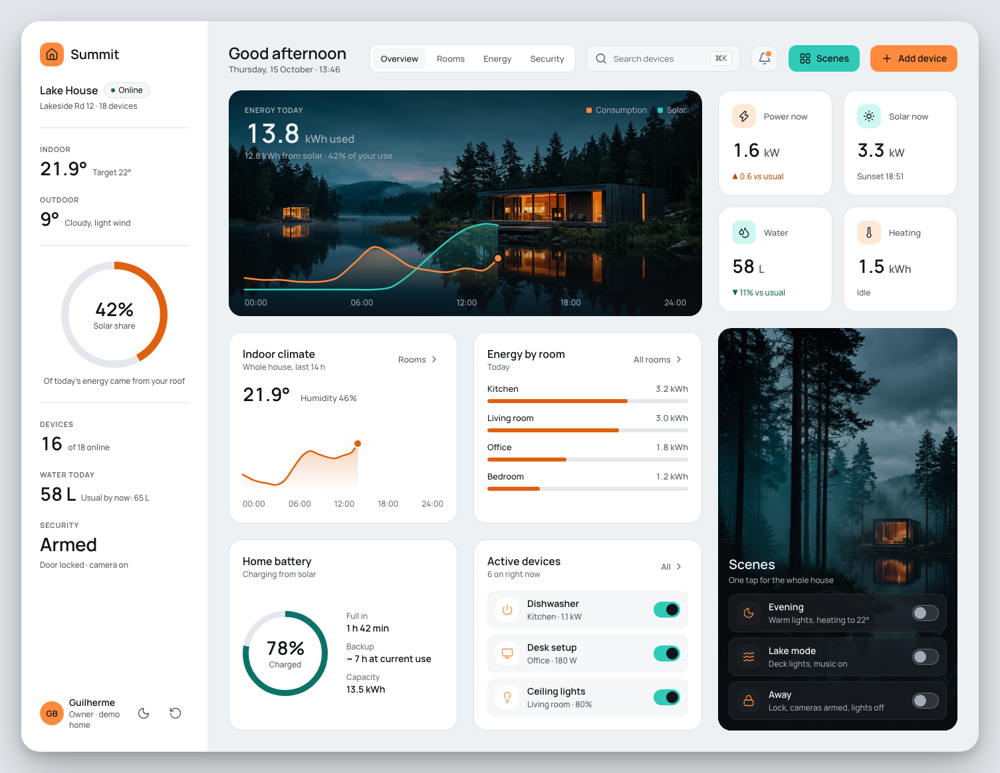
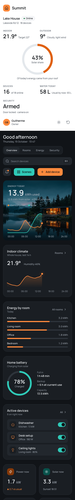

# Summit Home

[](https://github.com/guiboorges/summit-home/actions/workflows/pages.yml) [](https://guiboorges.github.io/summit-home/) [](https://github.com/guiboorges/summit-home/releases/latest) [](LICENSE) [](https://claude.com/claude-code)

A working smart home dashboard for a lake house, built with the **Summit** design system. It runs on a simulated home in your browser: switch devices, run scenes, and watch power, solar, the battery, and the indoor temperature respond.

**[▶ Open the live demo](https://guiboorges.github.io/summit-home/)**


| Light mode | Phone |
|---|---|
|  |  |

## What works

- **Devices:** switch lights, appliances, the purifier, the speaker, the lock, and the camera. Power now, energy by room, and the active devices list update right away.
- **Scenes:** Evening, Lake mode, and Away change several devices at once. A scene shows as on while the house matches it.
- **Energy:** today's consumption and solar curves end in a live point. Solar follows the sun (sunrise 07:30, sunset 18:51), and the solar share is what your roof covered.
- **Battery:** charges with surplus sun and drains at night, with "full in" or "lasts" estimates.
- **Climate:** the thermostat heats toward its target and the indoor temperature follows.
- **Search** (`⌘K`), **notifications** for everything that happens, **add a device**, **all devices**, and a **light/dark switch** (it follows your system by default).
- Your house is saved in the browser (`localStorage`). The reset button in the sidebar starts it again.

Only the Overview is built. Rooms, Energy, and Security are being designed in Figma first.

> The home is simulated. No real devices are connected and nothing leaves your browser. The battery and temperature move 20× faster than real time, so changes are visible in a demo; the clock and the charts use your real time.

## The design system

Summit was designed in Figma before any code: variables for color (Dark and Light modes), spacing, and radius, 13 text styles, 14 components, 29 icons, card patterns, and the dashboard screens. The tokens and the generated `summit.tokens.css` live in the [design-studio library](https://github.com/guiboorges/design-studio/tree/main/library/design-systems/summit); `src/styles/summit.tokens.css` is a copy of that file.

- Dark first. Elevation reads from lighter surfaces, not shadows.
- Orange is data and the primary action; teal is live systems and scenes. Labels on both use dark ink (7.9:1 and 9.0:1).
- Like Figma's explicit modes, any element can pin a mode with `class="summit-light"` or `class="summit-dark"`: the sidebar stays light, and the cards with photos stay dark so their text keeps its contrast.
- Text passes WCAG 2.2 AA in both modes. Switches use `role="switch"`, charts have text summaries, and motion stops under `prefers-reduced-motion`.

The lake house photos were generated with Figma AI. Icons are [Lucide](https://lucide.dev) (ISC). The typeface is [Manrope](https://fonts.google.com/specimen/Manrope) (OFL).

## Run it

```bash
npm install
npm run dev     # http://localhost:5173
npm test        # simulation tests
npm run build   # static site in dist/
```

React 19, TypeScript, and Vite, with no backend. The simulation is in `src/sim/model.ts` (pure functions) and `src/sim/useHome.ts` (state and the tick).
